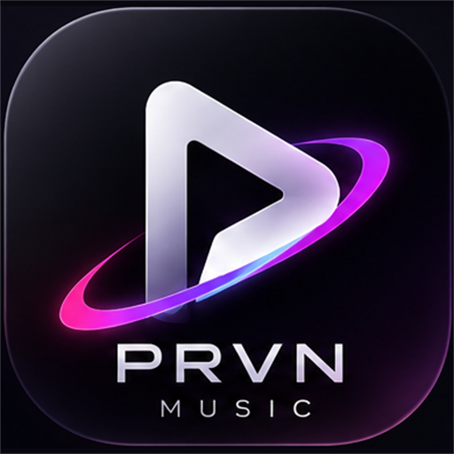

# PRVN Music

  
  <h2>PRVN Music v0.16.2</h2>
  
<strong>A Next-Generation Music Experience — High-Fidelity Streaming, Dynamic Player Styles, Synchronized Lyrics, Community Group Listening, Universal Cloud Sync & Native In-App Updates</strong>

  

    
    
    
    
  

---

## What's New in v0.16.2 & iOS v0.01

PRVN Music v0.16.2 introduces Listen Together Room Permissions, Universal Cloud Sync across Android, iPhone & Desktop, full elimination of third-party promotional prompts, and the official iPhone v0.01 release:

- 🛡️ **Zero Unwanted Third-Party Popups:** Completely purged upstream promotional star prompts, external developer review requests, and background blog notifications. Clean branding with **Developed by Pritam**.
- 👥 **Listen Together Room Permissions:** 3 granular permission modes: **Host Only**, **Everyone Can Control**, and **Approved Members**. Host can grant/revoke playback permissions and manage collaboration live.
- ⏱️ **Repaired Real-Time Playback Synchronization:** Fixed listener auto-pause issue on host track changes and 0:00 restart glitch; server clock calibration keeps all devices locked in sync.
- ☁️ **Universal Cloud Synchronization:** Single PRVN account syncing favorites, playlists, listening history, queue, and playback state across Android, iOS, and Desktop with active device arbitration.
- 📱 **PRVN Music for iPhone v0.01 (Build 1):** Initial iPhone release featuring background audio (`AVAudioSession`), lock-screen media controls (`MPNowPlayingInfoCenter`, `MPRemoteCommandCenter`), and safe-area Compose navigation.

- 📱 **Real Android Launcher Icon Switching:** Fixed dynamic launcher icon switching across all Android devices (Samsung OneUI, Xiaomi MIUI/HyperOS, OnePlus OxygenOS, Google Pixel, Realme, OPPO, Vivo, Motorola, Nothing). Uses native Android `Activity-Alias` components managed via `PackageManager` with safe-state transitions, preventing launcher icon removal or app crashes.
- 🎯 **18 Official Reference Logos Preserved:** Complete preservation of the 18 official logos from Concept Sheets 1 and 2 without distortion, stretching, or cropping. Includes the official default **V1 — Minimal Neon** and dual special editions (**V6 & V10 — Liquid Glass**).
- 🛡️ **Android Adaptive Icon Safe-Zone Compliance:** All adaptive launcher icons are engineered to maintain complete visibility within the 66dp Android safe zone. Lettering (`PRVN MUSIC`) and glowing symbols remain unclipped under circular, squircle, pebble, and rounded-square OEM launcher masks.
- 🔄 **Multi-Density Resource Pipeline:** Full density mipmaps generated for `mdpi`, `hdpi`, `xhdpi`, `xxhdpi`, `xxxhdpi`, and API 26+ `mipmap-anydpi-v26` adaptive layers.
- 🧹 **Complete Project Brand Cleansing:** Eradicated all inherited legacy YMusic icon files and XML drawables, aligning repository branding with the official PRVN Music identity.
- 🚀 **Universal Native In-App Updater:** Direct HTTPS background downloads, real-time byte counters (`XX.X MB / YY.Y MB`), transfer speed meter, ETA, pause/resume, cancel/retry, and SHA-256 APK integrity verification.

---

## Core Feature Highlights

### 1. Three Immersive Player Styles
- **Classic Player:** Minimalist, clean controls with smooth gestures and waveform seekbar.
- **Material 3 Expressive Player:** Google's expressive fluid motion system with responsive color extraction.
- **Apple Music-Inspired Player:** Elegant frosted liquid-glass backdrop, floating capsule controls, and synchronized lyrics overlay.

### 2. Audio Engineering & DSP
- **10-Band Graphic Equalizer:** Precision frequency manipulation with custom user presets.
- **AutoEq Headphone Profiles:** Integrated correction profiles for hundreds of audiophile headphone models.
- **AutoMix & Gapless Playback:** Seamless transitions with BPM matching and key detection.
- **Volume Normalization (ReplayGain):** Consistent loudness across diverse music catalogs.

### 3. Advanced Synced Lyrics
- Word-by-word synchronized karaoke lyrics.
- Real-time lyrics romanization (Japanese Furigana/Romaji, Korean Romaja, Chinese Pinyin, Cyrillic).
- Dual-engine lyrics translation and user timing offsets (±100ms adjustments).
- Shareable lyrics quote cards.

### 4. Group Listening (Listen Together)
- **Real-Time Synchronized Playback:** Join or host listening rooms using intuitive 4-digit room codes or custom WebSocket servers (`wss://`).
- **Low-Latency Sub-500ms Synchronization:** Real-time drift correction, monotonic clock calibration, and network latency compensation across all connected devices.
- **Collaborative Queue Management:** Listeners can suggest songs and upvote queued tracks, letting the room collectively decide upcoming music.
- **Full Host Governance:** Automatic join approvals or manual approval prompts, member kicking, host transfer, and persistent user blocklisting.
- **Cross-Platform Support:** Effortlessly synchronize music across Android phones, tablets, and Desktop computers.

---

## Downloads & Distribution

| Package | Target Platform | Architecture | Status |
| :--- | :--- | :--- | :--- |
| `PRVN-Music-v0.16.2-arm64.apk` | Android 8.0+ (API 26+) | `arm64-v8a` | **Recommended** |
| `PRVN-Music-v0.16.2-universal.apk` | Android 8.0+ (API 26+) | Universal (All ABIs) | Available |
| `PRVN-Music-v0.16.2.aab` | Google Play / Sideloading | Bundle | Release |
| `PRVN Music iOS` | iOS 16.0+ | arm64 (iPhone/iPad) | v0.01 (Build 1) |
| Desktop JAR / Native | Windows / Linux / macOS | x86_64 / aarch64 | JVM Target Available |

### Installation & Launcher Icon Notes
- **Launcher Caching:** When switching the app icon in **Settings → User Interface → App Icon**, Android updates the system `PackageManager` immediately. On certain OEM launchers (such as Samsung OneUI or Xiaomi HyperOS), the launcher may take a few moments to refresh its disk cache.
- **Upgrade Continuity:** Upgrading from v0.14 or v0.15 preserves all existing playlists, downloads, favorite tracks, and user settings seamlessly.

---

## Architecture & Open Source Attribution
PRVN Music is built using **Kotlin Multiplatform** and **Compose Multiplatform**. It builds upon the open-source foundation of [SimpMusic](https://github.com/maxrave-dev/SimpMusic) by Tuan Minh Nguyen Duc (maxrave-dev) licensed under **GNU General Public License v3.0 (GPL-3.0)**.
